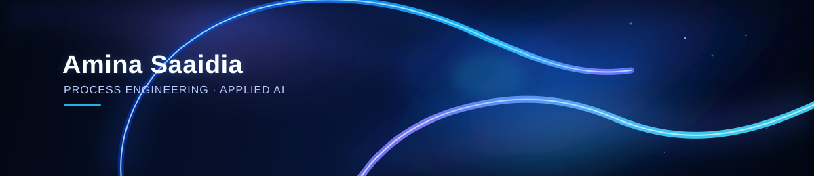

  

### Hi, I'm Amina 👋

Process Engineering graduate → M1 in Refining, building Python and AI skills to apply to industrial process problems: predictive maintenance, anomaly detection, and process optimization.

- 🔬 Background in refineries and gas treatment units (multiple internships)
- 🧠 Currently learning: Python for data science, applied ML fundamentals
- 🚀 First project: [`iris-classification`](https://github.com/amina-saaidia/iris-classification) — classic ML classification, learning the fundamentals before moving to process data
- 🏗️ Also known: Aspen HYSYS
- 📍 AIChE Student Chapter, Boumerdès

**What I'm working toward:** applying anomaly detection and predictive maintenance models to real refining/process data — bridging chemical engineering and machine learning.

📫 Let's connect — [LinkedIn](#) · [Email](#)
